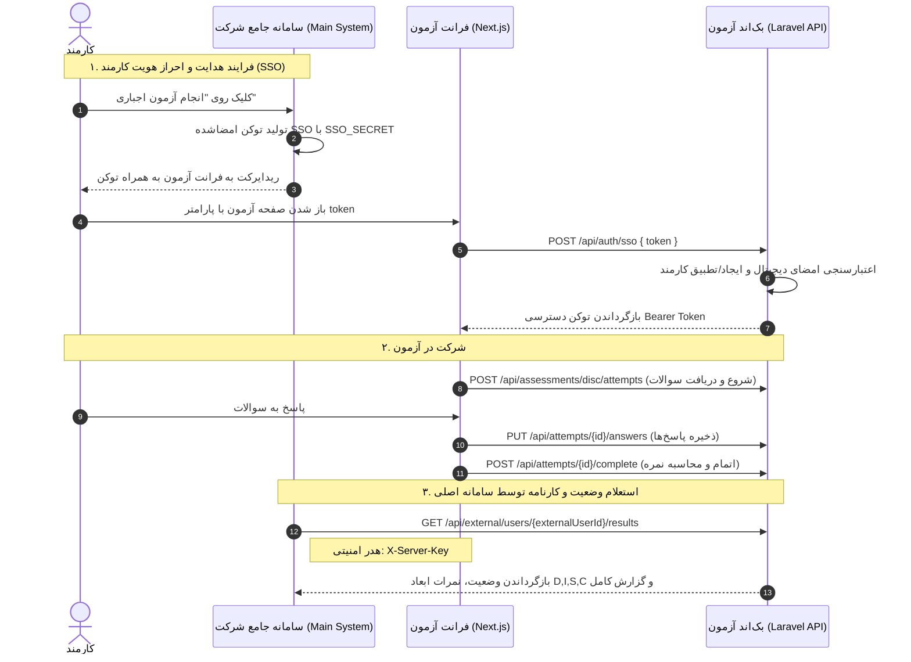

# راهنمای جامع اتصال و یکپارچه‌سازی سامانه اصلی با سامانه مدیریت آزمون
**Personality Assessment Platform - Integration Guide**

این مستند فنی برای تیم توسعه و برنامه‌نویسان **سامانه جامع سازمانی** تهیه شده است تا بتوانند به سادگی فرایند ارزیابی و انجام آزمون‌های روان‌شناختی (مانند آزمون DISC) را برای پرسنل سازمان فعال نموده و نتایج و کارنامه‌های حاصله را استعلام و ذخیره نمایند.

---

## ۱. فهرست مطالب
- [۲. سناریوی کاربردی (اجباری کردن آزمون و مشاهده نتایج)](#۲-سناریوی-کاربردی-اجباری-کردن-آزمون-و-مشاهده-نتایج)
- [۳. معماری کلی و دیاگرام جریان داده](#۳-معماری-کلی-و-دیاگرام-جریان-داده)
- [۴. مرحله اول: هدایت پرسنل به آزمون (SSO)](#۴-مرحله-اول-هدایت-پرسنل-به-آزمون-sso)
  - [ساختار توکن ورود یکپارچه](#ساختار-توکن-ورود-یکپارچه)
  - [نمونه کدهای تولید توکن (PHP, Node.js, Python, C#)](#نمونه-کدهای-تولید-توکن)
- [۵. مرحله دوم: استعلام نتایج کارمندان توسط سامانه اصلی (Server-to-Server)](#۵-مرحله-دوم-استعلام-نتایج-کارمندان-توسط-سامانه-اصلی-server-to-server)
  - [مشخصات اندپوینت](#مشخصات-اندپوینت)
  - [نمونه درخواست cURL و ساختار پاسخ](#نمونه-درخواست-curl-و-ساختار-پاسخ)
- [۶. استفاده از مستندات Swagger / OpenAPI](#۶-استفاده-از-مستندات-swagger--openapi)
- [۷. متغیرهای محرمانه و پیکربندی شبکه](#۷-متغیرهای-محرمانه-و-پیکربندی-شبکه)

---

## ۲. سناریوی کاربردی (اجباری کردن آزمون و مشاهده نتایج)

هدف سناریو این است که:
1. کارمند در پرتال سازمانی اعلانی مبنی بر **«تکمیل آزمون رفتارشناسی شغلی (DISC)»** دریافت می‌کند.
2. با کلیک بر روی دکمه «شروع آزمون»، بدون نیاز به ثبت‌نام مجدد یا وارد کردن نام‌کاربری و رمز عبور (به صورت **Single Sign-On**)، مستقیماً به صفحه آزمون منتقل می‌شود.
3. کارمند به سوالات پاسخ داده و آزمون را به اتمام می‌رساند.
4. سرور سامانه اصلی در هر لحظه (یا پس از پایان مهلت سازمانی) می‌تواند با استفاده از **شناسه پرسنلی کارمند**، وضعیت تکمیل آزمون، نمرات تفکیکی و تیپ شخصیتی او را به صورت مستقیم و امن از سرور آزمون استعلام کند.

---

## ۳. معماری کلی و دیاگرام جریان داده

ارتباط میان دو سامانه بر دو پایه استوار است:
1. **توکن امضاشده SSO کارمند (Client-Side Redirect)**: تبادل امن هویت کاربر بدون نیاز به اشتراک‌گذاری دیتابیس مشترک یا رمز عبور.
2. **وب‌سرویس سرور-به-سرور (S2S with Server Key)**: ارتباط مستقیم بک‌اند سامانه اصلی با بک‌اند سامانه آزمون با استفاده از کلید امنیتی سرور.



---

## ۴. مرحله اول: هدایت پرسنل به آزمون (SSO)

هنگامی که کارمند در سامانه اصلی روی دکمه شروع آزمون کلیک می‌کند، بک‌اند سامانه اصلی باید یک توکن امضاشده بسازد و کارمند را به آدرس فرانت‌ند آزمون منتقل نماید.

### ساختار توکن ورود یکپارچه

توکن از دو بخش تشکیل شده که با یک کاراکتر نقطه (`.`) به هم متصل می‌شوند:
```text
base64Url(payload) . base64Url(signature)
```

#### محتوای Payload (JSON):
| فیلد | نوع | الزامی؟ | توضیحات |
| :--- | :--- | :---: | :--- |
| `external_user_id` | رشته / عدد | **بله** | شناسه یکتای کارمند در سامانه اصلی (کد پرسنلی یا شناسه دیتابیس) |
| `name` | رشته | خیر | نام و نام خانوادگی کارمند جهت نمایش در کارنامه |
| `email` | رشته | خیر | ایمیل کارمند (در صورت ارسال، برای کاربر محلی ثبت می‌شود) |
| `source_system` | رشته | خیر | شناسه سامانه مبدأ (پیش‌فرض: `main_system`) |
| `expires_at` | عدد (Timestamp) | توصیه می‌شود | زمان انقضای توکن (یونیکس تایم‌استمپ؛ مثلا ۱۰ دقیقه آینده) |

#### نحوه محاسبه امضا (Signature):
الگوریتم امضا **HMAC-SHA256** است:
```text
rawSignature = hash_hmac('sha256', encodedPayload, SSO_SECRET, binary=true)
signature = base64UrlEncode(rawSignature)
```

---

### نمونه کدهای تولید توکن

توسعه‌دهنده سامانه اصلی بسته به زبان بک‌اند خود می‌تواند از توابع زیر استفاده نماید:

#### الف) نمونه کد در PHP / Laravel
```php
function generateSsoToken(array $userData, string $secret, int $ttlSeconds = 600): string
{
    $payload = [
        'external_user_id' => (string) $userData['id'],
        'name'             => $userData['name'] ?? null,
        'email'            => $userData['email'] ?? null,
        'source_system'    => 'main_system',
        'expires_at'       => time() + $ttlSeconds,
    ];

    $base64UrlEncode = function ($data) {
        return rtrim(strtr(base64_encode($data), '+/', '-_'), '=');
    };

    $encodedPayload = $base64UrlEncode(json_encode($payload, JSON_UNESCAPED_UNICODE));
    $rawSignature = hash_hmac('sha256', $encodedPayload, $secret, true);
    $encodedSignature = $base64UrlEncode($rawSignature);

    return "{$encodedPayload}.{$encodedSignature}";
}

// نحوه ریدایرکت:
// $token = generateSsoToken($user, config('services.assessment.sso_secret'));
// return redirect("https://quiz.company.com/sso?token={$token}&redirect=/assessments/disc");
```

#### ب) نمونه کد در Node.js / TypeScript
```typescript
import crypto from 'crypto';

interface UserPayload {
  id: string | number;
  name?: string;
  email?: string;
}

export function generateSsoToken(user: UserPayload, secret: string, ttlSeconds = 600): string {
  const payload = {
    external_user_id: String(user.id),
    name: user.name,
    email: user.email,
    source_system: 'main_system',
    expires_at: Math.floor(Date.now() / 1000) + ttlSeconds,
  };

  const base64Url = (buf: Buffer | string): string => {
    return Buffer.from(buf)
      .toString('base64')
      .replace(/=/g, '')
      .replace(/\+/g, '-')
      .replace(/\//g, '_');
  };

  const encodedPayload = base64Url(JSON.stringify(payload));
  const rawSignature = crypto.createHmac('sha256', secret).update(encodedPayload).digest();
  const encodedSignature = base64Url(rawSignature);

  return `${encodedPayload}.${encodedSignature}`;
}
```

#### ج) نمونه کد در Python
```python
import hmac
import hashlib
import json
import base64
import time

def base64url_encode(data: bytes) -> str:
    return base64.urlsafe_b64encode(data).decode('utf-8').rstrip('=')

def generate_sso_token(user_id: str, name: str, email: str, secret: str, ttl_seconds: int = 600) -> str:
    payload = {
        "external_user_id": str(user_id),
        "name": name,
        "email": email,
        "source_system": "main_system",
        "expires_at": int(time.time()) + ttl_seconds
    }
    
    payload_json = json.dumps(payload, ensure_ascii=False).encode('utf-8')
    encoded_payload = base64url_encode(payload_json)
    
    signature = hmac.new(secret.encode('utf-8'), encoded_payload.encode('utf-8'), hashlib.sha256).digest()
    encoded_signature = base64url_encode(signature)
    
    return f"{encoded_payload}.{encoded_signature}"
```

#### د) نمونه کد در C# / .NET
```csharp
using System.Security.Cryptography;
using System.Text;
using System.Text.Json;

public static class SsoHelper
{
    public static string GenerateSsoToken(string externalUserId, string name, string email, string secret, int ttlSeconds = 600)
    {
        var payload = new
        {
            external_user_id = externalUserId,
            name = name,
            email = email,
            source_system = "main_system",
            expires_at = DateTimeOffset.UtcNow.ToUnixTimeSeconds() + ttlSeconds
        };

        string json = JsonSerializer.Serialize(payload);
        string encodedPayload = Base64UrlEncode(Encoding.UTF8.GetBytes(json));

        using var hmac = new HMACSHA256(Encoding.UTF8.GetBytes(secret));
        byte[] rawSignature = hmac.ComputeHash(Encoding.UTF8.GetBytes(encodedPayload));
        string encodedSignature = Base64UrlEncode(rawSignature);

        return $"{encodedPayload}.{encodedSignature}";
    }

    private static string Base64UrlEncode(byte[] input)
    {
        return Convert.ToBase64String(input)
            .TrimEnd('=')
            .Replace('+', '-')
            .Replace('/', '_');
    }
}
```

---

## ۵. مرحله دوم: استعلام نتایج کارمندان توسط سامانه اصلی (Server-to-Server)

سامانه اصلی سازمان برای بررسی اینکه کدام کارمندان آزمون را به اتمام رسانده‌اند و مشاهده گزارش و نمرات آن‌ها، از این وب‌سرویس مستقیم استفاده می‌کند.

### مشخصات اندپوینت
- **آدرس:** `GET /api/external/users/{externalUserId}/results`
- **احراز هویت:** هدر `X-Server-Key: {SSO_SERVER_KEY}`
- **پارامترهای URL:**
  - `externalUserId`: شناسه کارمند در سامانه شما (همان مقداری که در توکن SSO ارسال شده بود).
  - `source_system` (اختیاری در Query String): در صورتی که در توکن مقداری غیر از `main_system` فرستاده‌اید.

### نمونه درخواست cURL
```bash
curl -X GET "https://quiz-api.company.com/api/external/users/emp_1001/results" \
  -H "Accept: application/json" \
  -H "X-Server-Key: your-super-secret-server-key"
```

### ساختار پاسخ موفق (200 OK)
```json
{
  "external_user_id": "emp_1001",
  "user": {
    "name": "علی رضایی",
    "email": "ali@company.com"
  },
  "total_attempts": 1,
  "data": [
    {
      "attempt_id": 142,
      "status": "completed",
      "assessment": {
        "slug": "disc",
        "name": "آزمون رفتارشناسی دیسک (DISC)",
        "version": "1.0.0"
      },
      "started_at": "2026-10-19T10:15:00+03:30",
      "completed_at": "2026-10-19T10:35:12+03:30",
      "result": {
        "scores": {
          "D": 28,
          "I": 22,
          "S": 15,
          "C": 18
        },
        "primary_type": "D",
        "report": {
          "summary": "شخصیت مسلط، مصمم، چالش‌پذیر و هدایت‌گر",
          "strengths": [
            "تصمیم‌گیری سریع",
            "تمرکز بر دستیابی به اهداف",
            "استقلال در حل مسائل"
          ],
          "growth_areas": [
            "افزایش صبر در کار گروهی",
            "توجه بیشتر به جزئیات ریز فرایندها"
          ]
        },
        "calculated_at": "2026-10-19T10:35:12+03:30"
      }
    }
  ]
}
```

### نکات کلیدی وضعیت‌ها:
- اگر فیلد `total_attempts` برابر با صفر یا `data` خالی باشد، یعنی کاربر هنوز آزمونی را به اتمام نرسانده است.
- وضعیت‌های ممکن برای هر نوبت (`status`):
  - `completed`: آزمون با موفقیت توسط کاربر سابمیت شده و نمره محاسبه شده است.
  - `timed_out`: مهلت قانونی کاربر به پایان رسیده و نمره بر اساس پاسخ‌های تا آن لحظه محاسبه شده است.
- در صورتی که کاربر اصلاً تا به حال وارد سامانه آزمون نشده باشد، خطای `404 Not Found` بازگردانده می‌شود:
  ```json
  {
    "message": "کاربری با این شناسه در سامانه آزمون یافت نشد.",
    "external_user_id": "emp_1001",
    "data": []
  }
  ```

---

## ۶. استفاده از مستندات Swagger / OpenAPI

فایل استاندارد OpenAPI نسخه ۳ در مسیر زیر در پروژه موجود است:
📁 `docs/openapi.yaml`

توسعه‌دهنده سامانه اصلی می‌تواند:
1. این فایل را مستقیماً در **[Swagger Editor (https://editor.swagger.io)](https://editor.swagger.io)** باز کند و به صورت تعاملی و بصری تمام اندپوینت‌ها، نمونه درخواست‌ها و مدل‌های داده را بررسی و تست نماید.
2. این فایل را مستقیماً در ابزارهایی مانند **Postman** یا **Insomnia** ایمپورت کند (Import -> File -> `openapi.yaml`) تا تمامی درخواست‌ها آماده فراخوانی در محیط کالکشن قرار گیرند.
3. در صورت نیاز به تولید خودکار تایپ‌ها یا SDK در کلاینت (مثلاً با `openapi-generator` یا `@hey-api/openapi-ts` یا `RTK Query`) از این فایل خروجی استاندارد بگیرد.

---

## ۷. متغیرهای محرمانه و پیکربندی شبکه

دو متغیر زیر باید میان مدیران فنی سامانه اصلی و سامانه آزمون به صورت امن مبادله شوند و در فایل `.env` هر دو سامانه تنظیم گردند:

| متغیر | نمونه مقدار | توضیحات |
| :--- | :--- | :--- |
| `SSO_SECRET` | `c48f...a921` | کلید محرمانه امضای دیجیتال برای توکن‌های ورود کاربران |
| `SSO_SERVER_KEY` | `9b1e...37d4` | کلید احراز هویت استعلام مستقیم وب‌سرویس‌های سرور-به-سرور |
| `SSO_SOURCE_SYSTEM`| `main_system` | نام کلید سامانه اصلی شرکت |

> **نکته امنیتی:** کلیدهای فوق محرمانه هستند و به هیچ عنوان نباید در کدهای فرانت‌ند کاربر قرار گیرند یا در گیت پابلیک کامیت شوند.

